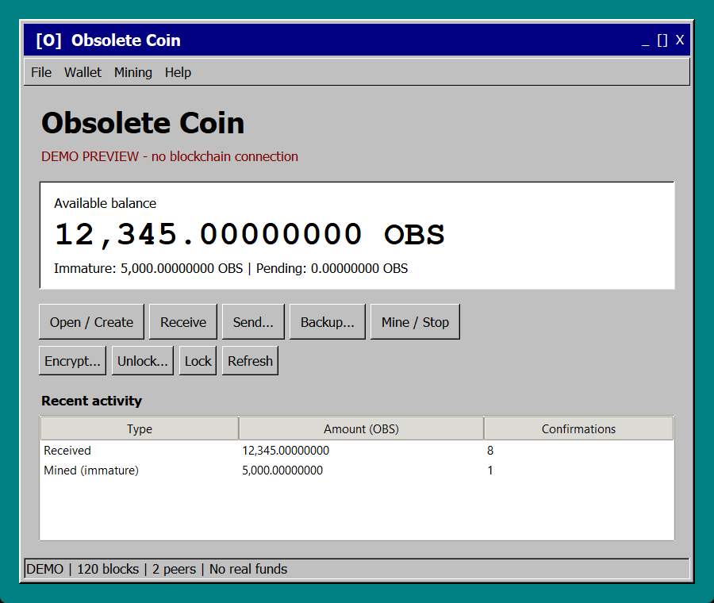

# Obsolete Coin

A deliberately slow, CPU-mined memecoin with a retro desktop wallet.
Ticker: **OBSC** (working symbol; no exchange listing or uniqueness claim).

**Experimental v0.2 testnet. Mainnet is disabled. Test coins have no monetary value.**
This is a working-source prototype, not audited production currency software.

v0.2 starts a new test chain with a new genesis, network identity and data subdirectory.
Old experimental balances and blocks do not carry over.



| Rule | Obsolete Coin |
| --- | --- |
| Mining | RandomX proof of work, CPU |
| Target block interval | 900 seconds / 15 minutes; actual waits vary |
| Difficulty | ASERT, every block, 6-hour half-life |
| Maximum authorized issuance | 1,000,000,000 OBSC |
| Precision | 8 decimals; integer accounting |
| Initial reward | 5,000 OBSC |
| Halving | Every 100,000 blocks, counted from block 1 |
| Genesis reward / premine | 0 / none |
| End of subsidy | Block 3,900,000; fees thereafter |
| Mining reward maturity | 100 blocks (about 25 hours at target) |
| Wallet | Local Core wallet, send/receive, encryption, backup |
| Testnet ports | P2P 19777; authenticated localhost RPC 19778 |

At target, halvings are about 2.85 years apart and the last subsidy about 111 years
after block 1. Difficulty follows hash power, not miner count; it cannot guarantee
a calendar schedule. A one-off 0.01300000 OBSC rounding remainder at the last
rewarded block makes the authorized schedule sum exactly to the cap. Unclaimed
rewards and lost keys reduce circulating supply.

## Public testnet participation

- [Website and downloads](https://obsoletecoin.pages.dev/)
- [Join guide and current first-node address](https://obsoletecoin.pages.dev/join.html)
- [Live explorer](https://obsoletecoin.pages.dev/explorer/index.html)
- [Release candidate](https://github.com/jcib/obsoletecoin/releases/tag/v0.3.0-testnet-rc1)
- [Report a reproducible problem](https://github.com/jcib/obsoletecoin/issues/new/choose)

The first node is a Dell Micro 7040 (2016). Its residential IP can change: use the
current peer shown on the join page and check its connection-verification status.
Testnet can reset without compensation and balances never convert into mainnet coins.
The initial test chain already contains locally mined test rewards; joining is not a
mainnet launch or an allocation of future mainnet coins. Independent operators welcome.

## Try it

Linux is the reference node platform. Build following [BUILD.md](docs/BUILD.md):

```sh
git clone --recurse-submodules https://github.com/jcib/obsoletecoin.git
cd obsoletecoin
# Build first, then start:
python3 tools/node.py
# In another terminal:
python3 tools/wallet.py
```

Click **Open / Create**, then **Receive**. **Mine / Stop** runs actual CPU mining
inside your local node. Newly mined coins need 100 confirmations before spending.
**Send** uses a 1-atom/vbyte test fee. **Encrypt** protects the wallet at rest;
make a new private backup afterward. Keep the passphrase safe.

Preview without a node: `python tools/wallet.py --demo` (also works on Windows).
A native Windows x64 wallet/node/miner is available as an unsigned test candidate.
It needs neither WSL nor Python. See [WINDOWS-NATIVE.md](docs/WINDOWS-NATIVE.md).

Windows laptop: see [WINDOWS.md](docs/WINDOWS.md) and the packaged `Start-Mining.cmd` launcher.

## Server and mining laptop

Run a full node on each machine; the laptop connects to the server through P2P.
Mining work runs on the laptop, without sharing RPC credentials.

```sh
# Home server, manual foreground process:
python3 tools/node.py --listen
# Laptop: replace YOUR_SERVER_LAN_IP:
python3 tools/node.py --peer YOUR_SERVER_LAN_IP:19777
python3 tools/wallet.py
# Or mine to an address already created by a wallet:
python3 tools/mine.py --address YOUR_TOBS1_ADDRESS
```

The included miner is a **single-threaded RandomX light-mode reference miner**,
not an optimized multi-core miner or pool. See [RUN.md](docs/RUN.md).

## Verification and provenance

GitHub Actions builds the actual C++ node and wallet, reproduces the experimental
genesis proofs, runs inherited unit suites plus Obsolete consensus tests, and
exercises two real nodes with disposable wallets. Integration covers mining,
RandomX seed rotation at height 64, signed transfers, invalid proof and excess
subsidy rejection, competing-chain reorganization, restart persistence, and encrypted-wallet backup
and restoration.
Python tests cover exact large balances, wrong-network protection and local RPC
authentication. Check the exact commit
in [Actions](https://github.com/jcib/obsoletecoin/actions); unfinished or failed CI
is not a passing build.

This fork is based on [Brisvia](https://github.com/brisvia/brisvia) and Bitcoin Core
30.2 with pinned upstream RandomX. Original licenses are preserved. Internal
Brisvia identifiers and `bitcoind` / `bitcoin-cli` build names remain for a
reviewable diff. The Obsolete launcher explicitly selects the new network.

- [Specification](docs/SPEC.md)
- [Build and verification](docs/BUILD.md)
- [Operation and backup](docs/RUN.md)
- [Security and outstanding launch work](docs/SECURITY.md)
- [Pinned upstream provenance](docs/UPSTREAM.md)

There is no exchange, pool, DNS seed network or checkpoint signer. Public bootstrap
initially depends on one home node; its availability is best effort. A dominant miner can reorganize a small PoW network.
Four confirmations do not guarantee finality or protection against that attack.
