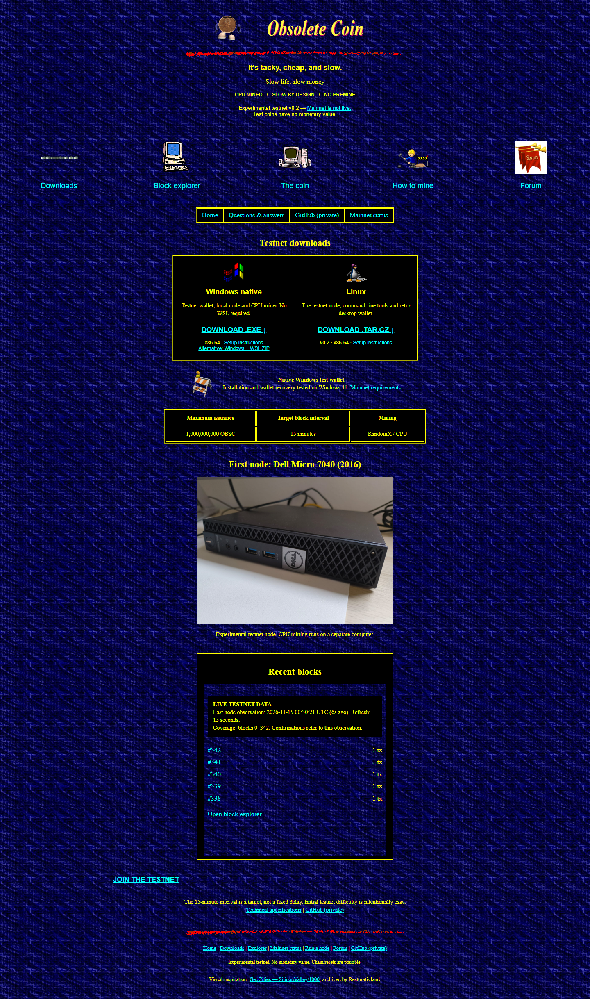

# Obsolete Coin (OBSC)

It's tacky, cheap, and slow.

**Experimental CPU-mined testnet. Mainnet is disabled. Test coins have no monetary value.**

[Website](https://obsoletecoin.pages.dev/) ·
[GitHub Releases](https://github.com/jcib/obsoletecoin/releases) ·
[Wallet downloads](https://obsoletecoin.pages.dev/downloads.html) ·
[Join the testnet](https://obsoletecoin.pages.dev/join.html) ·
[Explorer](https://obsoletecoin.pages.dev/explorer/index.html) ·
[Network statistics](https://obsoletecoin.pages.dev/explorer/network.html) ·
[Forum](https://obsoletecoin.pages.dev/forum) ·
[Run a node](https://obsoletecoin.pages.dev/nodes.html)

## What is available

- Native Windows x64 wallet, full node and CPU miner; no WSL required.
- Linux x86-64 package and an alternative Windows/WSL package.
- Local send/receive, transaction dates and confirmations, encryption and backups.
- A plain-HTML retro website on Cloudflare Pages, without music.
- A live explorer refreshed every 15 seconds, with explicit stale-data reporting.
- Estimated network power, canonical history, reward destinations and observed chain changes.
  These metrics do not count exact miners or prove independent ownership.
- Public-node discovery and external reachability checks, separate from first-node connections.
  Counts recently verified IPv4 testnet endpoints, not every node or independent operator.
- A simple forum: read discussions, open a topic or reply using an alias.
  No account is required; aliases are not authenticated or reserved.

The source repository and experimental prerelease binaries are public on GitHub.
Downloads are also mirrored on the website. Report issues in the forum, including
the package version, OS, reproduction steps and redacted error messages.
Never post wallet files, private keys, passwords or personal information.

## Network parameters

| Parameter | Testnet |
| --- | --- |
| Ticker | OBSC |
| Proof of work | RandomX, CPU |
| Target block interval | 900 seconds / 15 minutes; actual intervals vary |
| Difficulty | ASERT, adjusted every block; 6-hour half-life |
| Maximum authorized issuance | 1,000,000,000 OBSC |
| Precision | 8 decimals; integer accounting |
| Initial reward | 5,000 OBSC |
| Halving | Every 100,000 blocks, counted from block 1 |
| Genesis reward / premine | Zero / none |
| Reward maturity | 100 blocks |
| End of subsidy | Block 3,900,000; fees afterward |
| P2P | TCP 19777 |
| RPC | TCP 19778, authenticated and local only |

The first node is a Dell Micro 7040 (2016). Get its current public peer address from
the Join guide; do not rely on an old IP copied from a forum post.

At the target interval, halvings are approximately 2.85 years apart. Difficulty
follows hash power, not miner count, and cannot guarantee a calendar schedule.
A final 0.01300000 OBSC rounding remainder makes the authorized subsidy schedule
sum to the cap. Unclaimed rewards and lost keys reduce circulating supply.
The inherited timestamp format needs an upgrade before 2106.

## Try the testnet

1. Download a wallet and compare its SHA-256 with the published checksums.
2. Connect to the current peer shown in the Join guide.
3. Wait for synchronization and compare your tip with the explorer.
4. Use **Open / Create**, then **Receive** to obtain an address.
5. Use **Mine / Stop** for the single-thread reference miner, or receive test coins
   from another participant.
6. Once funds are spendable, use **Send**. Newly mined rewards require 100-block
   maturity; a received transfer and an immature mining reward are different.
7. Encrypt the wallet and make a private backup. Keep the passphrase separately.

The current chain is experimental v0.2. It already contains test mining rewards.
It may reset, and test balances will not become mainnet balances. Four confirmations
do not guarantee safety against a dominant miner on a small network.

## Run an independent node

Follow the [public node guide](https://obsoletecoin.pages.dev/nodes.html).
A full node verifies blocks, signatures and issuance rules, relays transactions,
and can provide synchronization data to other participants. Mining is optional;
being online alone does not earn a reward.

The current Windows desktop app is outbound-only. For an inbound node, use the
Linux/WSL dedicated-node guide. Outbound-only nodes can still validate. Permit and,
where necessary, forward TCP 19777. Never expose RPC 19778 or enable a router's
DMZ-host option. Keep software updated and monitor disk space and traffic.
More independently operated nodes improve reachability and independent validation;
they do not substitute for mining hash power.

## Verification and limitations

Real disposable-node integration covers RandomX mining, peer synchronization,
sending from the desktop wallet, receipt of funds, reward maturity, duplicate
submission, insufficient funds, invalid blocks, reorganizations, restarts,
encryption, backup and restoration. A fresh external node has also synchronized
the public testnet.

The forum and explorer are tested against Workerd and D1, including escaped user
content, form authentication, duplicate submissions, posting limits and feed
replay/reorganization handling. Forum messages are plain text; no uploads.

These tests are not an independent security audit or a mainnet readiness claim.
Mainnet remains blocked pending independent review, sustained adversarial testing
and operational readiness. See [MAINNET-READINESS.md](docs/MAINNET-READINESS.md).

## Development

For repository collaborators: [build](docs/BUILD.md), [specification](docs/SPEC.md),
[Windows](docs/WINDOWS-NATIVE.md), [website](website/README.md).
Public participants should use the website guides and packages.

Derived from Brisvia and Bitcoin Core, with RandomX. Original copyright and license
notices are retained; see [COPYING](COPYING) and the notices in distribution packages.
Asset provenance and visual inspiration are recorded in [website/ASSETS.md](website/ASSETS.md).
